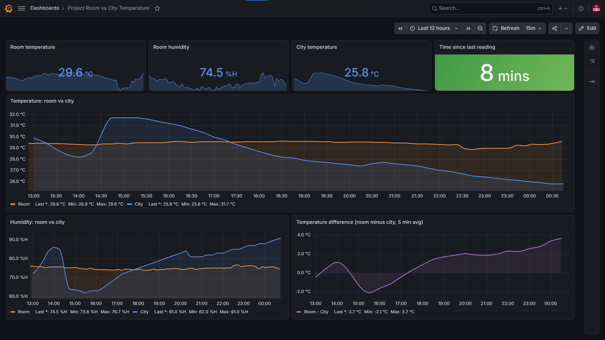

# Room Monitor
### Status: Done
  

An ESP32 + BME280 node that logs room temperature and humidity, compares them with the outdoor conditions in my city, and charts both in Grafana.

**Hypothesis:** My room is cooler than outside on hot days and warmer on cool days.

**Result:** True to some extent. Need more data, possibly in another project.


## Documentation


## Features
 
- [x] FreeRTOS
- [x] Wi-Fi + MQTT, NTP-stamped JSON payloads
- [x] LittleFS buffering and replay
- [x] Dockerised Mosquitto, Telegraf, InfluxDB 3 and Grafana stack
- [x] Grafana dashboard with city comparison
- [x] **OTA firmware updates**
- [x] **Reliable data delivery**
  - [x] Any failed upload data to MQTT is stored inside ESP32
  - [x] Mutexes for LittleFS and I2C bus
  - [x] Persist `message_id` across reboots
- [x] **Wi-Fi Manager:**
- [x] Deep sleep

## Run

**Clone** 
```sh
git clone https://github.com/vlncn/Room_Monitor.git
cd Room_Monitor
```

**Backend** 
1. Configure the `.env` file. Fill the missing value.
2. `docker compose up -d`  


**Grafana:** 
1. Add an InfluxDB data source in **SQL** mode (URL `http://<influxdb-host>:8181`, database = your bucket) 
2. Add dashboard by importing `grafana/dashboard_template.json`.

**Firmware:**
1. In the Arduino IDE, install the ESP32 board package and the libraries PubSubClient, Adafruit BME280, Adafruit Unified Sensor, Adafruit GFX, Adafruit SSD1306 and Wi-Fi Manager.
2. Select your ESP32 board, then build and upload.

## Repository layout

```
firmware/            ESP32 sketch
mosquitto/config/    broker configuration
telegraf/            Telegraf Configuration
grafana/             dashboard JSON
docker-compose.yml   Mosquitto + Telegraf + InfluxDB 3 Core + Grafana
```

## License

MIT, see [LICENSE](LICENSE).