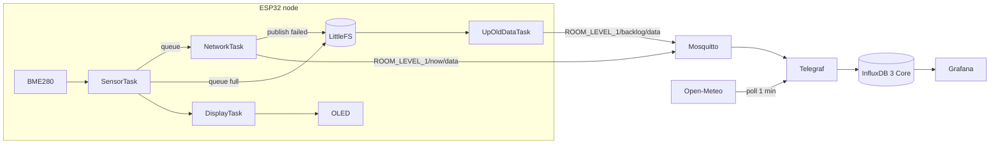

# Room Monitor

  

An ESP32 + BME280 node that logs room temperature and humidity, compares them with the outdoor conditions in my city (Samarinda), and charts both in Grafana.

**Hypothesis:** my room is cooler than outside on hot days and warmer on cool days.

## Status: MVP

the full pipeline works end to end, from sensor to live dashboard. I built a working prototype (a thin slice that runs, then harden it), and I'm now working through the remaining items to take it from a working prototype to a product-grade device. The gaps are listed openly in [Roadmap](#Roadmap).

**Working Features**

- Periodic BME280 readings, timestamped on the device with NTP time
- MQTT delivery into InfluxDB 3 via Telegraf, with the city's temperature and humidity polled from Open-Meteo alongside
- A Grafana dashboard: current room and city values, room-vs-city charts, their difference, and a time-since-last-reading indicator
- Offline tolerance (first version): readings are buffered to flash when Wi-Fi or MQTT is down and replayed afterwards
- Everything server-side runs from one `docker compose up`

<!--  -->

## Architecture



## Firmware

Arduino-framework sketch (`firmware/esp32_room_monitor.ino`) running FreeRTOS tasks on the ESP32. BME280 and a 0.96" SSD1306 OLED share one I2C bus (SDA GPIO21, SCL GPIO22, 400 kHz; addresses 0x76 and 0x3C).

| Task | Core | Priority | Role |
|---|---|---|---|
| `SchedulerTask` | 1 | 4 | Waits for NTP sync, then wakes the sensor and network tasks every `MEASURE_INTERVAL_MS` using `vTaskDelayUntil` |
| `SensorTask` | 1 | 3 | Takes a forced BME280 measurement, stamps it, builds the JSON and enqueues it |
| `NetworkTask` | 0 | 2 | Maintains Wi-Fi/MQTT, publishes queued readings, falls back to flash on failure |
| `UpOldDataTask` | 0 | 1 | Replays buffered readings from LittleFS once the link is back |
| `DisplayTask` | 1 | 1 | Shows the latest reading, or a sensor error, on the OLED |

**Design notes**

- **Event-driven, no polling.** Tasks wake each other with FreeRTOS task notifications.
- **Fixed-period sampling.** `vTaskDelayUntil` prevents drift, and the scheduler waits for NTP so nothing is stamped 1970.
- **Timestamp travels with the reading.** UTC time is captured at measurement and queued with the values, so a reading buffered for an hour still lands at the right place on the chart.
- **Low self-heating.** The BME280 runs in forced mode (1x oversampling, pressure off, filter off) and measures only when triggered.
- **Store-and-forward.** If the queue is full or a publish fails, the reading goes to a LittleFS log. Replay uses a separate `backlog` topic, and lines that fail to send are kept via a temp-file swap.
- **Safe to replay.** InfluxDB overwrites a point with the same series and timestamp, so duplicate deliveries don't create duplicate points.

**Payload** (JSON over MQTT)

```json
{"message_id":1042,"device_id":"ESP32_01_ROOM_LEVEL_1","temp":28.40,"hum":71.20,"measure_at":"2026-11-11T08:30:00Z"}
```

## Roadmap
 
The MVP is shipped. The remaining work takes it from a working prototype to a product-grade device, roughly in priority order. tracking task is in [TO DO LIST.md](TO%20DO%20LIST.md).
 
**Done (MVP)**
 
- [x] Bare-metal to FreeRTOS migration
- [x] Wi-Fi + MQTT, NTP-stamped JSON payloads
- [x] LittleFS buffering and replay (first version)
- [x] Dockerised Mosquitto, Telegraf, InfluxDB 3 and Grafana stack
- [x] Grafana dashboard with city comparison and device-status indicator
**Next: product hardening**
 
- [ ] **OTA firmware updates** (high priority)
- [ ] **Reliable data delivery** (high priority)
  - [ ] Fix the replay race (a reading buffered during a replay can be lost)
  - [ ] Mutexes for the LittleFS log, the shared MQTT client and the I2C bus
  - [ ] Delivery confirmation (MQTT is QoS 0 via `PubSubClient`, so `publish()` success only means the packet was written to the socket not to database)
  - [ ] Health checks across ESP32, Telegraf and InfluxDB
  - [ ] Persist `message_id` across reboots (the `Preferences` code exists but is disabled)
- [ ] **Error handling:** error codes for sensor, OLED, Wi-Fi and MQTT faults, and a connectivity indicator on the OLED
- [ ] **Wi-Fi Manager:** provisioning without reflashing (medium priority)
**Later**
 
- [ ] Deep sleep and power management

## Run it

**Clone** 
```sh
git clone https://github.com/vlncn/Room_Monitor.git
cd Room_Monitor
```

**Backend:** `docker compose up -d` starts Mosquitto, Telegraf, InfluxDB 3 Core and Grafana. Configure them in a `.env` file (not committed): `INFLUXDB_*` (node ID, host, token, org, bucket), `TELEGRAF_*` (interval, topics, latitude/longitude) and `GRAFANA_*` (admin login). InfluxDB 3 Core has auth enabled, so create an admin token first (`influxdb3 create token --admin`).

**Grafana:** add an InfluxDB data source in **SQL** mode (URL `http://<influxdb-host>:8181`, database = your bucket), then import `grafana/suhu-dashboard.json`.

**Firmware:**
1. In the Arduino IDE, install the ESP32 board package and the libraries PubSubClient, Adafruit BME280, Adafruit Unified Sensor, Adafruit GFX and Adafruit SSD1306.
2. Create `config.h` next to the sketch (keep it out of git):
   ```cpp
   const char* ssid        = "YOUR_WIFI";
   const char* password    = "YOUR_PASSWORD";
   const char* mqtt_server = "192.168.x.x"; 
   ```
3. Select your ESP32 board, then build and upload.

## Repository layout

```
firmware/            ESP32 sketch
mosquitto/config/    broker configuration
telegraf/            Telegraf Configuration
grafana/             dashboard JSON
docker-compose.yml   Mosquitto + Telegraf + InfluxDB 3 Core + Grafana
```

## License

MIT, see [LICENSE](.\LICENSE).